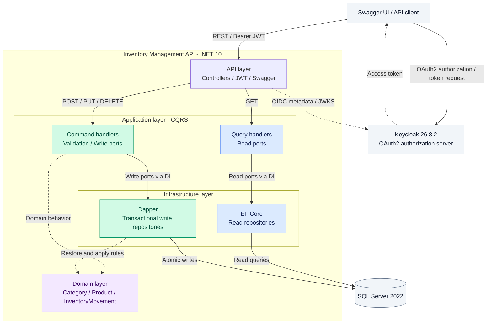
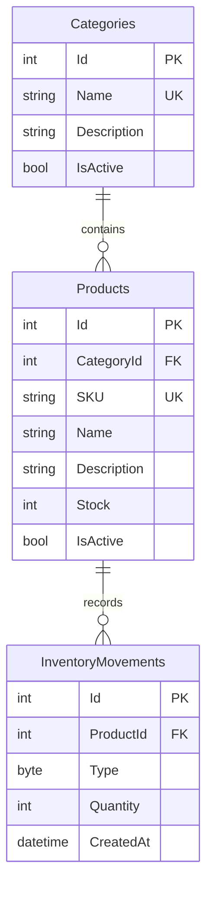

# Inventory Management API — Architecture

Technical assessment for Redarbor — Senior Developer.

This document describes the implemented design and its trade-offs. The approved [functional specification](SPEC.md) defines the API contract; the [README](../README.md) describes installation, usage and testing. The [AI usage log](AI_USAGE.md) records the specification-first workflow, prompts and candidate decisions.

## 1. Architecture overview

The solution is a modular monolith built with .NET 10 LTS, ASP.NET Core, Clean Architecture and explicit CQRS. .NET 10 satisfies the assessment's .NET 8+ requirement and provides a supported LTS baseline. A single deployable API and a single SQL Server database keep operational complexity proportional to the inventory domain.

### Runtime architecture

Blue identifies the read path; green identifies the write path. Both use the same database. The diagram shows runtime collaboration through dependency injection, not compile-time project references. Dashed arrows show supporting interactions with domain behavior and the identity provider.

| Project | Responsibility |
|---|---|
| Domain | Category, Product, InventoryMovement and business invariants |
| Application | Use cases, validation, CQRS handlers and persistence abstractions |
| Infrastructure | SQL connections, EF Core mappings, repositories and transactions |
| API | Controllers, HTTP contracts, OAuth2, OpenAPI, errors and composition root |

Compile-time dependencies: Application → Domain; Infrastructure → Application and Domain; API → Application and Infrastructure. Domain has no infrastructure dependencies. Runtime dependency injection connects the application ports to their infrastructure implementations.

## 2. CQRS and application design

- Eleven typed command/query handlers implement the business endpoints. Controllers delegate to them rather than accessing data directly.
- EF Core 10 handles reads through `AsNoTracking`, DTO projections, active-record filtering and deterministic ID ordering. Dapper handles all application writes using parameterized SQL.
- Five narrow persistence ports separate category/product reads, category/product writes and movement registration. No generic repository, generic Unit of Work or mediator library is introduced.
- Built-in DI registers handlers, validators, repositories and `InventoryDbContext` as scoped services; `SqlConnectionFactory` and `TimeProvider.System` are singletons. The API owns composition.
- FluentValidation validates inputs explicitly in handlers. Cancellation tokens propagate to persistence. State-dependent rules are checked inside the write protocol rather than through race-prone preliminary queries.

CQRS separates responsibilities, not databases or processes. The design does not require eventual consistency, event sourcing or message brokers. Count and page retrieval are separate queries and do not guarantee snapshot consistency under concurrent writes.

## 3. Domain and relational model

| Concern | Decision |
|---|---|
| Identity | SQL Server integer identity keys; gaps are acceptable |
| Text | Name up to 150, SKU up to 50, optional description up to 500 characters after trimming |
| Uniqueness | Case-insensitive category name and SKU, reserved even after deactivation |
| Stock | Initially zero; nonnegative; changed only by inventory movements |
| Movement | Positive quantity; Entry = 1, Exit = 2 internally; UTC `datetime2(7)` |
| Deletion | Logical deactivation; no cascading or application-level physical deletes |
| Indexes | Unique name/SKU; products by category/active state; movements by product/time |

Entities use private setters and explicit behavior. `ProductDetails` and `CategoryDetails` group related parameters; domain entities retain validation ownership. `Restore` reconstructs persisted categories/products. Inactive resources cannot be updated; products with stock and categories with active products cannot be deactivated. Movements are immutable through the application and timestamps come from `TimeProvider`, not the client. UTC records movement construction time, not necessarily commit time.

SQL Server enforces foreign keys, uniqueness, nonblank required fields, valid movement types, positive quantities and stock constraints (including zero stock for inactive products). Application rules also require an active category. The restricted `inventory_app` account has SELECT, INSERT and limited column-level UPDATE permissions, but cannot update movements or physically delete records. Permissions alone do not enforce the entire transactional protocol.

## 4. Atomicity and concurrency

Inventory consistency is the primary persistence requirement. Each movement uses one SQL connection and one explicit ReadCommitted transaction:

1. Read the product by primary key with `UPDLOCK, HOLDLOCK` and restore its domain state.
2. Apply `RegisterEntry` or `RegisterExit`, checking active status, quantity, available stock and overflow.
3. Update exactly one product row and insert the movement in the same transaction.
4. Commit only when both writes succeed. Dispose/rollback an uncommitted transaction on failure.

All stock mutations and product deactivation share the product locking protocol. Product creation, category reassignment and category deactivation coordinate through category locks. Reassignment locks the affected categories in ascending ID order before locking the product, then revalidates its original category. If that category changed, the operation retries in a new transaction, at most three attempts. Category deactivation checks for active products while holding its category lock.

A proposed additional conditional stock update was not retained: locked domain state, single-row update verification and SQL constraints protect the current write path. Forced constraint failure verified rollback between stock update and movement insertion. Seven concurrency scenarios passed in ten additional repeated runs; only the controlled concurrent-exit test explicitly observed lock contention. These results do not prove deadlocks are impossible. General deadlock retries and request idempotency are outside the current design; an uncertain commit must not be blindly retried because movements could be duplicated.

## 5. HTTP contracts and validation

All eleven business endpoints are under `/api/v1`. Request DTOs are separate from entities and reject unmapped JSON properties, preventing direct writes to stock, active state, timestamps or generated IDs. Movement type accepts exactly `Entry` or `Exit`. Pagination defaults to page 1 and size 20, maximum 100.

Validation has three responsibilities: Application validates input shape and limits; Domain normalizes values and protects invariants; Infrastructure coordinates transactional state rules and database constraints. Native ASP.NET Core exception handling translates known validation, domain and persistence errors into ProblemDetails (`application/problem+json`), with a stable code and trace ID. Unknown failures return a generic 500 without stack traces or SQL details.

Category/product creation returns 201 with ID and Location; movement registration returns 201 with ID only (no movement lookup route). Update/deactivation returns 204. Known invalid inputs, missing/inactive resources and conflicts return 400, 404 and 409 respectively. Authentication and authorization failures return 401 and 403.

Swashbuckle is the sole OpenAPI generator. Swagger UI is Development-only, uses PKCE and describes request schemas, required properties, enum values, pagination and expected responses. Phase 9 added explicit schema and parameter filters; normalized-input rules remain authoritative in the server and specification.

## 6. OAuth2 and authorization

Keycloak 26.8.2 is the authorization server; the API is a JWT Bearer resource server.

| Setting | Value |
|---|---|
| Realm | `inventory` |
| Audience | `inventory-api` |
| Required scope | `inventory.access` |
| Swagger client | `inventory-swagger` — public, Authorization Code + PKCE S256 |
| Service client | `inventory-service` — confidential, Client Credentials |
| Access token lifetime | 300 seconds (5 minutes) |
| JWT clock skew | 30 seconds |

The API validates RS256 signatures, exact issuer/audience, lifetime and the complete case-sensitive scope value. Invalid/missing credentials return 401; an authenticated caller lacking the scope receives 403. The browser uses `http://localhost:8081/realms/inventory` as issuer; container metadata is reachable through `http://keycloak:8080/realms/inventory`. Dynamic backchannel configuration resolves internal token/JWKS endpoints without relaxing issuer checks. Both flows were exercised against actual Keycloak in Phase 8.

Swagger requires no client secret. The shared scope is deliberately not fine-grained RBAC. HTTP metadata, embedded Keycloak storage, demo users and bootstrap administration are local evaluation settings, not production identity infrastructure.

## 7. Deployment and configuration

| Compose service | Function |
|---|---|
| `sqlserver` | SQL Server 2022 Developer (CU28), named data volume |
| `db-init` | One-shot database, schema and restricted permission initialization |
| `keycloak` | Realm import, token issuance and named identity data volume |
| `api` | Multi-stage .NET 10 Linux image, Release build, non-root runtime |

SQL Server must be healthy before initialization; API startup requires healthy SQL Server/Keycloak and successful db-init. The initializer performs bounded availability checks (30 attempts, three-second connection/query timeouts, two-second delay) before database initialization. The three versioned SQL scripts preserve existing data; they are not a general migration or schema-drift engine. Existing Keycloak realms are not overwritten.

The API connects to `sqlserver:1433`; published SQL Server, API and Keycloak ports bind to loopback (14330, 8080, 8081 by default). Environment variables configure the application; Docker Compose consumes `.env`, whereas local Visual Studio debugging uses User Secrets. The API does not receive administrator passwords or the confidential OAuth2 client secret.

The Windows `setup.ps1` script generates five separate credentials using 32 cryptographically random bytes per value plus a complexity prefix, writes a git-ignored `.env` and opens it in Notepad. Existing files are preserved without validation or rotation. No credentials are embedded in the repository or printed by the script. The `.env` and User Secrets are local plaintext configuration, not a production secret store. The candidate confirmed completion of the fresh-checkout evaluator workflow in Phase 9.

Anonymous `/health/live` checks process availability; `/health/ready` runs `SELECT 1` with the restricted application account and a five-second timeout. Readiness does not validate the entire schema or Keycloak. A controlled database outage verified liveness 200, readiness 503 and recovery to 200 without restarting the API. Named volumes preserved database records and Keycloak signing keys during recreation.

## 8. Verification and quality

The test suite uses xUnit, Moq, Testcontainers, TestServer, WebApplicationFactory and Coverlet. Unit tests exercise domain behavior and use cases; integration tests exercise actual SQL Server, EF/Dapper persistence, rollback, concurrent operations, HTTP contracts, DI, JWT validation, Swagger and health endpoints. Full-host tests use the real API entry point and controlled identity metadata/signing keys; actual Keycloak flows were checked separately. Integration databases are isolated from local development data.

| Local evidence | Result |
|---|---|
| Phase 9 full regression | 551 passed, 0 failed, 0 skipped (candidate-reported) |
| Phase 5 Domain unit coverage | 96.31% lines / 100.00% branches |
| Phase 6 Application unit coverage | 96.70% lines / 88.46% branches |
| Phase 8 integration aggregate coverage | 97.84% lines / 88.10% branches |

Coverage figures are historical, separate runs, not merged coverage for the 551-test regression. Local execution and supplied evidence were reviewed; static repository inspection is not independent execution. TDD and AI-assisted decisions are recorded in the AI usage log. SDK selection, shared build settings and central package versions are versioned. CI/CD is not part of the assessment scope and was not implemented.

## 9. Trade-offs and known limitations

- The modular monolith and explicit CQRS avoid distributed coordination and mediator infrastructure. A shared scope is sufficient for the stated authorization contract; future roles or multi-tenancy would require a new design.
- SQL initialization is repeatable for the current schema; schema evolution, uncertain-commit retries and request idempotency are not implemented.
- SQL Server CU28 exhibited exit 137 after Docker stop timeouts, with `OOMKilled=false`. The behavior is consistent with [upstream issue #968](https://github.com/microsoft/mssql-docker/issues/968), but the exact cause was not established. Native SQL `SHUTDOWN` was acknowledged and returned exit 255; the system recovered. `DBCC CHECKDB` reported no allocation or consistency errors after earlier forced stops. This is not proof that forced termination is safe. The image remains unchanged.
- Data Protection keys are ephemeral and not additionally encrypted in the local API container. Current JWT authentication does not rely on server-side authentication cookies.
- Local HTTP, certificate trust and development identity configuration must not be carried into production. Production requires TLS, managed secrets, identity hardening, backups and deployment-specific operations. No production readiness or container vulnerability-scan claim is made.

## 10. Decision traceability

This document consolidates the previous 29 ADRs without treating implementation milestones as new architectural decisions. The original ADR history remains available in Git; the AI usage log contains the reasoning and candidate review.

| Original ADRs | Current sections |
|---|---|
| 001–002, 009, 014–015, 017–020 | 1–2, 3, 7 |
| 003–004, 010–011, 013 | 3–4 |
| 006, 021–022, 024 | 5 |
| 005, 023 | 6 |
| 007, 026–028 | 7 |
| 008, 012, 016, 025, 029 | 8–9 |

Implementation and local regression are complete for the defined business scope. The candidate confirmed completion of the fresh-checkout evaluator workflow in Phase 9.
